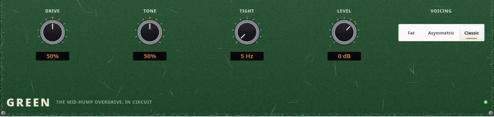

# OpenRig FX

[](https://github.com/Siryu6/openrig-fx/actions/workflows/ci.yml)
[](https://github.com/Siryu6/openrig-fx/releases/latest)
[](LICENSE)

[Website](https://openrig.eu/fx) · [OpenRig](https://github.com/Siryu6/OpenRig) ·
[Releases](https://github.com/Siryu6/openrig-fx/releases) ·
[Contributing](CONTRIBUTING.md)

Real-time-safe audio effects for guitar, written in Rust, shipped as LV2
plugins and as JACK standalone programs. They are the in-house effects of
[OpenRig](https://openrig.eu), the open pedalboard, and run in any LV2 host
(OpenRig, Ardour, Carla, jalv, MOD-like systems).

| Plugin | Status |
|---|---|
| OR Tremolo, OR Tremolo Stereo | Reference plugin: classic, opto and harmonic voicings, stereo spread and auto-pan, tempo sync |
| OR Echo, OR Echo Stereo | Digital, tape and analog (BBD) voicings, ping-pong, tempo sync, ducking, wow and flutter, anti-aliased saturation, filters in the feedback loop, click-free time changes, trails on bypass |
| OR Plate | Stereo plate reverb (modulated figure-eight tank), decay in seconds for lows, mids and highs, pre-delay, filters on the reverb, freeze, trails on bypass |
| OR EQ | Parametric EQ: low and high cut, low and high shelves, three bells with Q, output level; zero latency, curve drawn by the host from the declared bands |
| OR Graphic EQ | Seven-band guitar graphic EQ (100 Hz to 6.4 kHz octaves) with output level |
| OR Drive | Boost, overdrive, distortion and fuzz from circuit behaviour, tone voiced per circuit, bass before the clipping, level-matched modes, 4x oversampled antiderivative clipping, crossfaded mode changes |
| OR Gate | Noise gate: threshold with 6 dB hysteresis, hold, decay, range (gate to gentle expander), gain reduction meter, bit-transparent while open |
| OR Comp | Guitar compressor: threshold, ratio, soft knee, attack, release, level, blend for parallel compression, gain reduction meter, bit-transparent below the threshold |
| OR Green Drive | Circuit model of the classic mid-hump op-amp overdrive: diodes in the feedback solved per sample (Newton), 720 Hz gain leg, tone network, buffers; Classic, Fat and Asymmetric voicings; OpenRig Tight high pass before the clipping for boosting high-gain amps |
| OR Black Dist | Circuit model of the classic op-amp hard-clipping distortion: high-gain op-amp with its gain-bandwidth, slew rate and rails, diodes to ground solved per sample, passive filter, 8x oversampled; OpenRig diode selector (silicon, LED, none: rail clipping), level-matched |
| OR Drop | Down-tuning, octaves and momentary dives in the time domain (pitch-synchronous splices of a delay line, no filterbank): -24 to +12 semitones, Dive toggle with its own target and glide time, Mix with a phase-aligned dry; Tight (6 ms) and Quality (14 ms) modes, latency reported to the host |
| OR Splinter | Tempo-synced glitch on a footswitch: beat repeats of 1/4 to 1/32 (triplets included) with repeat count, decay and pitch step per repeat, reverse, tape stop and spin-up in beats; chop patterns (metal gallop, breakdown), bit and sample-rate crush, repeatable chaos; quantised to the host bar or its own tempo, forgiving a late press, zero latency, step grid view |



## Install

- **On OpenRig**: open the plugin store and install OpenRig FX. Updates
  come the same way.
- **Any other LV2 host on Linux**: download the archive for your machine
  (`x86_64` or `aarch64`) from the
  [latest release](https://github.com/Siryu6/openrig-fx/releases/latest),
  check it against `SHA256SUMS`, and copy the `.lv2` folders into
  `~/.lv2`:

  ```sh
  sha256sum -c --ignore-missing SHA256SUMS
  tar xf openrig-fx-0.1.0-x86_64.tar.gz
  cp -r openrig-fx-0.1.0-x86_64/*.lv2 ~/.lv2/
  ```

The x86_64 build runs on any 64-bit PC and picks AVX2 code at run time
when the processor has it. The aarch64 build runs on a Raspberry Pi 4 or 5
and other 64-bit ARM boards.

## Layout

| Path | What |
|---|---|
| `crates/orx-dsp` | DSP building blocks (filters, smoothers, LFOs, delay lines), allocation in constructors only |
| `crates/orx-simd` | SIMD strategy: autovectorised loops, AVX2/FMA kernels picked at run time |
| `crates/orx-plugin` | Format-neutral plugin model and the `Runner` every wrapper drives |
| `crates/orx-lv2` | Hand-written LV2 binding, Turtle generator, `openrig:` vocabulary, test host |
| `crates/orx-standalone` | JACK client for one plugin, probe and dummy-server helpers |
| `crates/orx-test` | Test kit: signals, golden files, RT allocation trap, conformance suite, bench |
| `crates/orx-suite` | Registry of the plugins and of the bundles that ship them |
| `plugins/tremolo` | OR Tremolo (`lv2/`: its LV2 library) |
| `plugins/echo` | OR Echo (`lv2/`: its LV2 library) |
| `plugins/plate` | OR Plate (`lv2/`: its LV2 library) |
| `plugins/eq` | OR EQ and OR Graphic EQ (`lv2/`: their LV2 library) |
| `plugins/drive` | OR Drive (`lv2/`: its LV2 library) |
| `plugins/gate` | OR Gate (`lv2/`: its LV2 library) |
| `plugins/comp` | OR Comp (`lv2/`: its LV2 library) |
| `plugins/greendrive` | OR Green Drive (`lv2/`: its LV2 library) |
| `plugins/blackdist` | OR Black Dist (`lv2/`: its LV2 library) |
| `plugins/drop` | OR Drop (`lv2/`: its LV2 library) |
| `plugins/splinter` | OR Splinter (`lv2/`: its LV2 library) |
| `apps/orx-run` | `orx-run`, the JACK standalone |
| `xtask` | `cargo xtask`: bundle assembly and validation |
| `ns/openrig-view.ttl` | The `openrig:` vocabulary (generated) |
| `docs/` | [Design](docs/DESIGN.md), [native view vocabulary](docs/OPENRIG-VIEWS.md) |

## Build and test

Rust 1.90 or later. Building needs no C library: libjack is loaded at run
time.

```sh
cargo test --workspace
cargo clippy --workspace --all-targets
cargo bench -p orx-tremolo
cargo bench -p orx-echo
cargo bench -p orx-plate
cargo bench -p orx-eq
cargo bench -p orx-drive
cargo bench -p orx-gate
cargo bench -p orx-comp
cargo bench -p orx-green-drive
cargo bench -p orx-black-dist
cargo bench -p orx-drop
```

`ORX_BLESS=1 cargo test` rewrites the golden files after an intended change
of sound.

## LV2 bundles

```sh
cargo xtask bundle                 # test, build, assemble, validate
cargo xtask bundle --strict        # same, and a check that cannot run fails (CI)
cargo xtask validate DIR.lv2...    # validate assembled bundles
```

Bundles land in `<target>/bundles/<triple>/`, e.g.
`target/bundles/x86_64-unknown-linux-gnu/or-tremolo.lv2`. Copy one into
`~/.lv2` (desktop) or the pedalboard's LV2 directory to use it.

Validation runs the plugin tests first (a bundle declares
`lv2:hardRTCapable` only for plugins passing the RT suite), then checks
the Turtle files (as generated, `serdi` syntax, `lv2_validate` schemas,
`openrig:` terms), the ELF dependencies and glibc symbol versions against
the OpenRig image, and, for a binary of the build machine, loads it
through the C ABI, runs `lv2lint`, and plays audio through it under
`jalv` on a private dummy JACK server. Tools: `serdi`, `sord_validate` /
`lv2_validate` (lilv-utils, lv2-dev), `lv2lint`, `jalv`, `jackd`.

### In OpenRig's host

```sh
cargo xtask openrig-host ~/src/openrig
```

builds a check against an OpenRig checkout and runs every plugin through
OpenRig's own discovery and effect chain, bit-exact against the plugin's
reference runner.

### Raspberry Pi (aarch64)

With a cross GCC (`gcc-aarch64-linux-gnu`):

```sh
CARGO_TARGET_AARCH64_UNKNOWN_LINUX_GNU_LINKER=aarch64-linux-gnu-gcc \
    cargo xtask bundle --target aarch64-unknown-linux-gnu
```

Without one, `scripts/aarch64-sysroot.sh` copies a Debian bookworm arm64
sysroot out of a container and prints the settings for clang and lld:

```sh
scripts/aarch64-sysroot.sh target/aarch64-sysroot
eval "$(scripts/aarch64-sysroot.sh --env target/aarch64-sysroot)"
cargo xtask bundle --target aarch64-unknown-linux-gnu
```

## JACK standalone

```sh
cargo run --release -p orx-run -- --list
cargo run --release -p orx-run -- tremolo --connect --set depth=80 --cc 1=depth
```

Options: `--name`, `--bpm` (when the JACK transport has no tempo),
`--set SYMBOL=VALUE`, `--preset ID`, `--cc NUMBER=SYMBOL`, `--connect`
(first capture to the inputs, outputs to the first playbacks). On stdin:
`SYMBOL=VALUE`, `preset ID`, `bypass on|off`, `params`, `meters`,
`presets`, `quit`.

## Roadmap

- New effects: a swell and shimmer reverb.
- In OpenRig: read the `openrig:` vocabulary (views, roles, faceplates)
  instead of inferring views, bypass through `lv2:enabled` so trails ring
  out, and draw the echo timeline.
- In OpenRig, for OR Splinter: send the moving bar position so slices
  land on the band's bar, a momentary footswitch for HOLD, and draw the
  step grid view and the Glitch plate.
- OR Echo: optional noise of a bucket-brigade line, gated so the tail
  still ends.

Ideas and reports are welcome in the
[issues](https://github.com/Siryu6/openrig-fx/issues).

## Contributing

See [CONTRIBUTING.md](CONTRIBUTING.md). Security problems: see
[SECURITY.md](SECURITY.md). Contact: contact@openrig.eu.

## License

GPL-3.0-or-later. See [LICENSE](LICENSE).
